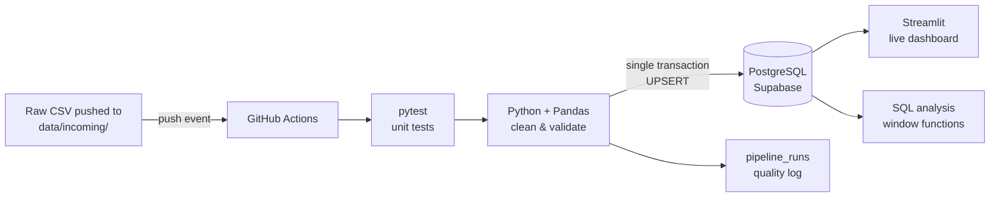

# Event-Driven Sales Data Pipeline (GitHub Actions + PostgreSQL + Streamlit)

Upload a raw sales CSV, and within about a minute it is automatically tested, cleaned, loaded into a
PostgreSQL warehouse and reflected in a live dashboard. No servers to manage, and it runs entirely on
free tiers with no credit card.



## What the cleaning step handles

Tested on generated data with problems injected on purpose (`scripts/generate_sample_data.py`):

| Problem | Fix |
|---|---|
| Messy headers (`Sub-Category`, `Order Date `) | Normalised to `snake_case` |
| Exact duplicate rows, repeated order IDs | Removed, first occurrence kept |
| Numbers stored as text (`₹1,250.00`) | Symbols/commas stripped, parsed to numbers |
| Two date formats (`2026-09-05`, `05-Sep-2026`) | Parsed with mixed-format parsing |
| Inconsistent casing/spaces (`" north "`) | Trimmed and title-cased |
| Missing sales / quantity / price | Derived from the other two (sales = qty × price) |
| Missing profit | Sales × median margin of that category, flagged `profit_imputed` |
| Missing region/category | Set to `Unknown`, so revenue isn't lost from totals |
| Missing order ID/date, zero or negative quantity | Dropped (unrecoverable) |

Example run on a 2,060-row file: 60 duplicates removed, 71 values derived, 60 profits imputed,
34 rows dropped, 1,966 rows loaded. Re-sending the same file creates **no duplicates** (UPSERT on `order_id`).

## Project structure

```
.github/workflows/pipeline.yml   # trigger: runs on every CSV pushed to data/incoming/
src/clean.py                     # cleaning + validation rules
src/load_postgres.py             # transactional UPSERT into Postgres + run log
src/pipeline.py                  # entry point, run report in the Actions job summary
dashboard/app.py                 # Streamlit dashboard (filters, KPIs, charts)
sql/analysis.sql                 # analysis queries (window functions, JSONB)
scripts/generate_sample_data.py  # realistic messy test data
tests/                           # unit tests + Postgres integration test
```

## Run it locally (no accounts needed)

```bash
pip install -r requirements.txt
python scripts/generate_sample_data.py --rows 2000 --month 2026-09 --out data/incoming/sales_2026_09.csv
pytest -q
python -m src.pipeline data/incoming/sales_2026_09.csv --dry-run   # writes data/processed/*_clean.csv
```

## Deploy it (free, no card)

### 1. Database: Supabase
1. Sign up at **supabase.com** with your GitHub account → **New project**.
2. Set a database password using **only letters and numbers** (symbols break the connection string). Save it.
3. When the project is ready, click **Connect** and copy the **Session pooler** connection string.
   Use the pooler, not "Direct connection": GitHub's servers need the pooler's IPv4 address.
4. Replace `[YOUR-PASSWORD]` in it with your password. This full string is your `DATABASE_URL`.

### 2. GitHub
1. Create an empty repo `serverless-sales-pipeline` (no README).
2. Repo → **Settings → Secrets and variables → Actions → New repository secret**:
   `DATABASE_URL` = the connection string from step 1.4.
3. Push this folder to `main`. The first push processes the two sample files: check the **Actions** tab.
4. In Supabase → **Table Editor**, you should see `sales_clean` (3,936 rows) and `pipeline_runs`.

### 3. Dashboard: Streamlit Community Cloud
1. Go to **share.streamlit.io** and sign in with GitHub → **Create app → Deploy a public app from GitHub**.
2. Repo `serverless-sales-pipeline`, branch `main`, main file `dashboard/app.py`.
3. **Advanced settings → Secrets**, paste:
   ```toml
   DATABASE_URL = "your connection string"
   ```
4. Deploy. You get a public link: put it in this README and on your resume.

### 4. Try the automation
```bash
python scripts/generate_sample_data.py --month 2026-11 --seed 11 --out data/incoming/sales_2026_11.csv
git add . && git commit -m "Add November sales" && git push
```
The pipeline runs by itself; click **Refresh data** on the dashboard to see November.

### Known limits (free tiers)
- Supabase pauses free projects after about a week with no activity. Before an interview, open the
  Supabase dashboard and click **Restore** if it's paused.
- Streamlit apps sleep when unused and wake up (about 30 seconds) on the next visit.

## Design decisions (useful for interviews)
- **Event-driven and serverless:** compute runs only when a file arrives (GitHub Actions); nothing is always on.
- **Tests gate the load:** unit tests run before every load, so broken code never touches the warehouse.
- **One transaction per file:** staging table → UPSERT → run log. A failure rolls everything back; no half-loaded files.
- **Idempotent UPSERT:** re-sending a file, or a corrected order, updates rows instead of duplicating them.
- **Flag, don't hide, imputed values:** `profit_imputed` lets analysis exclude estimated numbers.
- **Data quality log:** each run's cleaning report is stored as JSONB in `pipeline_runs` and shown in the dashboard.
- **Secrets never in code:** the connection string lives only in GitHub and Streamlit secrets.
